# ecs

本文先介绍推荐的应用集成方式, 再展开数据存储、查询、系统调度、直接世界操作和编译期实现.

相关头文件为 [`<neutron/ecs.hpp>`](../../include/neutron/ecs.hpp).

## 目录

- [推荐使用方式](#推荐使用方式)
- [快速开始](#快速开始)
- [核心概念](#核心概念)
  - [实体](#实体)
  - [组件](#组件)
  - [系统](#系统)
    - [commands](#commands-命令)
    - [query](#query-实体查询)
    - [command_list](#command_list-命令列表)
    - [global](#global-全局参数)
    - [local](#local-系统本地存储)
    - [res](#res-世界存储)
    - [meta_accessor](#meta_accessor-元数据访问)
    - [自定义系统参数](#自定义参数)
  - [世界描述符](#世界描述符)
    - [add_systems](#add_systems)
    - [execute](#execute)
    - [enable_render & enable_events](#enable_render--enable_events)
    - [set_identifier](#set_identifier)
    - [自定义描述符](#自定义描述符)
- [底层接口](#底层接口)
- [内部实现](#内部实现)
- [基准测试](#基准测试)

## 推荐使用方式

推荐应用通过 `app::create() | run_worlds<...>()` 接入 ECS：  
`app::create()` → `run_worlds<world...>()` → `app::run<world...>()` → `make_runtime<world...>(scheduler_provider, payload)` → `runtime.run()`  
`app` 负责平台生命周期、事件循环、线程池和内存资源. `runtime` 负责调度 world、执行阶段和控制帧循环.   

当然, 您也可以按需使用，引入更为底层的世界、执行环境或 archetype 等底层接口, 集成到自定义的运行环境, 以实现更细粒度的控制.

## 快速开始

以下为一个不能编译的接口示例. 示例省略了 `app`、scheduler provider、payload 和内存资源的具体实现, 因此不能直接编译，但展示了各层接口如何衔接：

```cpp
using namespace neutron;

struct Position {
    using component_concept = component_tag;
    float x{};
    float y{};
};

void begin_update(commands commands) {
    commands.spawn(Position{0.0f, 0.0f});
}

constexpr auto desc =
    world_desc | add_systems<stage::update, &begin_update>;

struct app {
    static app create();

    template <auto... Worlds>
    int run(auto&&... config) {
        auto provider = /* scheduler provider */;
        auto payload  = /* frame lifecycle */;
        auto runtime =
            make_runtime<Worlds...>(provider, &payload, /* allocator */);
        return runtime.run();
    }
};

int main(int argc, char* argv[]) {
    return app::create() | run_worlds<desc>(argc, argv);
}
```

接口关系如下：

- 组件类型带有 `component_concept` 标记.
- 系统是普通函数, 可以请求组件数据、命令接口、资源和局部状态等.
- `add_systems` 把系统注册到阶段, 并组合成 world 描述符.
- `run_worlds` 把描述符和配置交给 `app::run<Worlds...>()`.
- `app::run` 准备 scheduler provider、payload 和内存资源, 并创建 `make_runtime<Worlds...>`.
- `runtime.run()` 驱动帧循环, 按阶段执行 world.

`app` 可以自行决定配置参数、payload 如何结束帧循环, 以及如何管理线程和内存资源. 具体实现可对照
[`tests/include/app.hpp`](../../tests/include/app.hpp)；
`run_worlds` 的调用形式见 [`tests/src/ecs/runtime/run.cpp`](../../tests/src/ecs/runtime/run.cpp).

## 核心概念

### 实体

在使用完整 `neutron` 的情况下, 所遇到的实体多为 `entity_t` 或 `future_entity_t`, 它是一个划分实体身份的 id, 除此以外不存储任何具体信息.  

### 组件

组件是普通 C++ 类型, 可以通过 `component_concept` 类型成员标记，也可以特化 `as_component` 启用. 组件不需要继承基类或运行时注册，类型信息和描述符元数据都在编译期推导.

以下是一个组件标记示例：

```cpp
using namespace neutron;

struct Position {
    using component_concept = component_tag;
    /* data */
};

struct ExternalType {
    /* data */
};

template <>
constexpr bool as_component<ExternalType> = true;
```

空组件不会被存储, 但依旧会参与哈稀计算.  

### 系统

系统可以是自由函数或不带有捕获列表的 lambda 表达式, 其参数数量、顺序不固定, 但每一个参数需能通过 `construct_from_world` 进行构造:  

```c++
template <stage Stage, auto Sys, typename T>
struct construct_from_world_t {
    template <internal::world World>
    constexpr T operator()(World& world) const
        noexcept(std::is_nothrow_constructible_v<T, World>) {
        return T(world);
    }
};

template <stage Stage, auto Sys, typename T>
inline constexpr construct_from_world_t<Stage, Sys, T> construct_from_world;
```

接下来会为您介绍可用的系统参数.

#### `commands`: 命令

`commands` 用于对实体及其组件列表进行修改, 参考以下示例:

```c++
void fn(commands commands) {
    // spawn a entity
    auto entity = commands.spawn<Position>();

    // get mesh from some place
    auto mesh = /* ... */;

    // add component for this entity
    commands.add_components(entity, mesh);

    // add more componentns for this entity
    commands.add_components<Velocity, Rotation, Name>(entity);

    // remove a component
    commands.remove_components<Name>(entity);

    // remove more components
    commands.remove_components<Velocity, Rotation>(entity);

    // kill the entity
    commands.kill(entity);
}
```

尽管我们支持 `add_components` 或 `remove_components`, 但由于 SoA 批量存储, 进行增删组件总是意味着实体迁移。

通过 `commands` 进行的操作都为立即完成, 因此对实体进行组件增删尽量一次性完成, 避免逐个增删组件导致的反复迁移.

#### `query`: 实体查询

`query` 用于进行实体查询, 其参数被称为 "查询过滤器".

查询的结果通过成员函数 `get`, `get_with_entities`, `entities` 以范围的形式返回结果.

```c++
void fn(query<with<Position&, const Velocity&>> qry, commands cmds) {
    for (auto [pos, vel] : qry.get()) {
        pos.x += vel.x;
        pos.y += vel.y;
    }

    for (auto [e, pos, vel] : qry.get_with_entity()) {
        e.add_component(e);
        pos.x += vel.x;
        pos.y += vel.y;
    }
}
```

虽然该参数名为 "query", 但并非每次都会进行查询:  
我们会通过一些编译期的技巧以事先为高频调用的查询生成可供持续访问的查询结果, 并通过特殊的容器确保查询结果能用于访问当前的最新状况, 所以当一个世界被使用一段时间后, `query` 几乎是没有开销的——这就是模板元编程和 SoA 的潜能.  

#### `command_list`: 命令列表

相对于 `commands`, `command_list` 则提供了一种延迟的修改方案, 它会将需要执行的操作记录到预先准备好的命令缓冲区, 并在合适的时候进行真正的修改.

它会使用 `future_entity_t` 来表示即将生成的实体, 除此之外, 其接口与 `commands` 几乎一致:

```c++
void fn(command_list cl, query<with<Position>> qry) {
    // spawn a entity
    auto entity = cl.spawn<Position>();

    // get mesh from some place
    auto mesh = /* ... */;

    // add component for this entity
    cl.add_components(entity, mesh);

    // add more componentns for this entity
    cl.add_components<Velocity, Rotation, Name>(entity);

    // remove a component
    cl.remove_components<Name>(entity);

    // remove more components
    cl.remove_components<Velocity, Rotation>(entity);

    // kill the entity
    cl.kill(entity);

    // operation on living entity
    for (auto e : qry.entities()) {
        cl.remove_components<Position>(e);
    }
}
```

#### `global`: 全局参数

在一些情况下, 我们或许需要一些全局存在的参数来实现多世界的数据共享或传输, 因此我们引入了 `global`:

```c++
void fn(global<std::atomic<uint64_t>&> glob) {
    auto [atomic] = glob
    auto v = atomic.load();
}
```

`global` 提供了一种全局访问的方式, 其模板参数数量没有限制, 每一个模板参数需满足可默认构造.   

其模板参数所对应实例拥有**静态存储**生命周期.  

#### `local`: 系统本地存储

由于 `global` 访问的实例具有静态存储, 同类型变量无法多次声明, 因此, 我们引入了系统本地存储, 多系统间数据访问互不干扰.

```c++
void fn(local<int> loc) {
    auto [i] = loc; // { i } -> int&
    println("{}", ++i);
}
```

#### `res`: 世界存储

我们引入 `res` 主要是为了实现世界内的数据共享, 虽然 `global` 已经能做到这一点, 但同步的范围太大了, 而且在多数情况下, 变量可能不需要静态存储.  

```c++
void fn(res<int&> res) {
    auto [i] = loc;
    println("{}", ++i);
}
```

由于统一时刻可能有多个系统访问世界存储, 所以需要通过值、常量引用、引用来显式声明访问权限 (访问方式).  

#### `meta_accessor`: 元数据访问

在 `neutron` 中的大部分实体操作都通过模板实现, 这意味着高性能, 但问题是有时我们也需要一定的灵活性, 所以我们提供了 `meta_accessor` 来实现非侵入式的数据交互.  

```c++
void fn(commands cmds, meta_accessor accessor) {
    auto it = accessor.find("position");
    cmds.add_component(cmds, e, it);
}
```

`meta_accessor` 提供了基本的实体访问, 但如果需要组件数据访问, 需要更进一步地将数据以类型擦除的方式暴露给外部.   

#### 自定义参数

您可通过特化 `construct_from_world_t` 使您的自定义类型满足该约束, 从而实现自定义参数.  

```c++
template <stage Stage, auto Sys, typename T>
struct construct_from_world_t {
    template <internal::world World>
    constexpr T operator()(World& world) const
        noexcept(std::is_nothrow_constructible_v<T, World>) {
        return T(world);
    }
};

template <stage Stage, auto Sys, typename T>
inline constexpr construct_from_world_t<Stage, Sys, T> construct_from_world;
```

### 世界描述符

#### `add_systems`

#### `execute`

#### `enable_render` & `enable_events`

#### `set_identifier`

#### 自定义描述符 

## 底层接口

在通常情况下优先使用 descriptor / runtime 的高层接口, 但如果为了细粒度控制, neutron 同样提供了支持.  

### `archetype`

### `world_base`

## 底层实现

### `archetype`: 组件连续的存储

### `world_base`: 最基本的世界

### `command_buffer`: 无虚函数的类型擦除存储

### `world_descriptor_t`: 编译期数据推导

### `querior`: 查询复用

### `run_env`: sender / receiver 模型

## 基准测试

下面这些图位于 [`../image`](../image), 仅作参考.

需要说明的是：

- 基准结果基于 MIT 协议仓库 [abeimler/ecs_benchmark](https://github.com/abeimler/ecs_benchmark) 修改得到, 并非本仓库 `benchmark` 目录的输出.
- 所用 `neutron` 版本为 `bfa6c9e0cd008d53bb96e02e654a307eff2860e5`, 早于当前版本；当前版本已加入查询缓存 `slice`.
- 测试代码、数据规模和版本均可能与当前实现不同, 结果只用于观察趋势.

### 实体创建与结构变更

空实体创建：

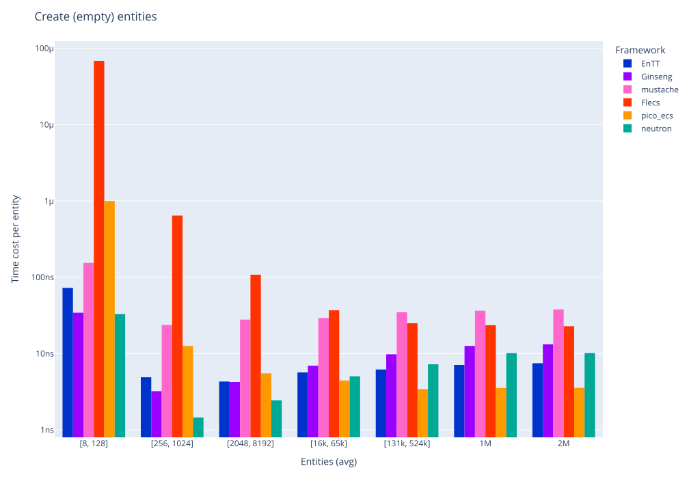

批量创建空实体：

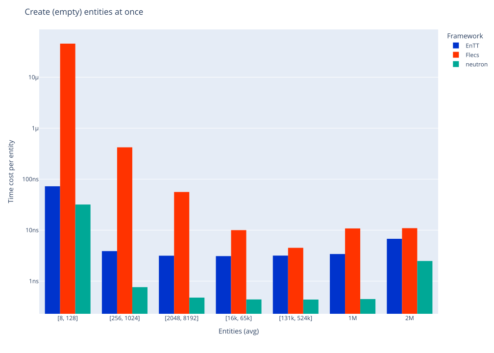

创建带组件实体：

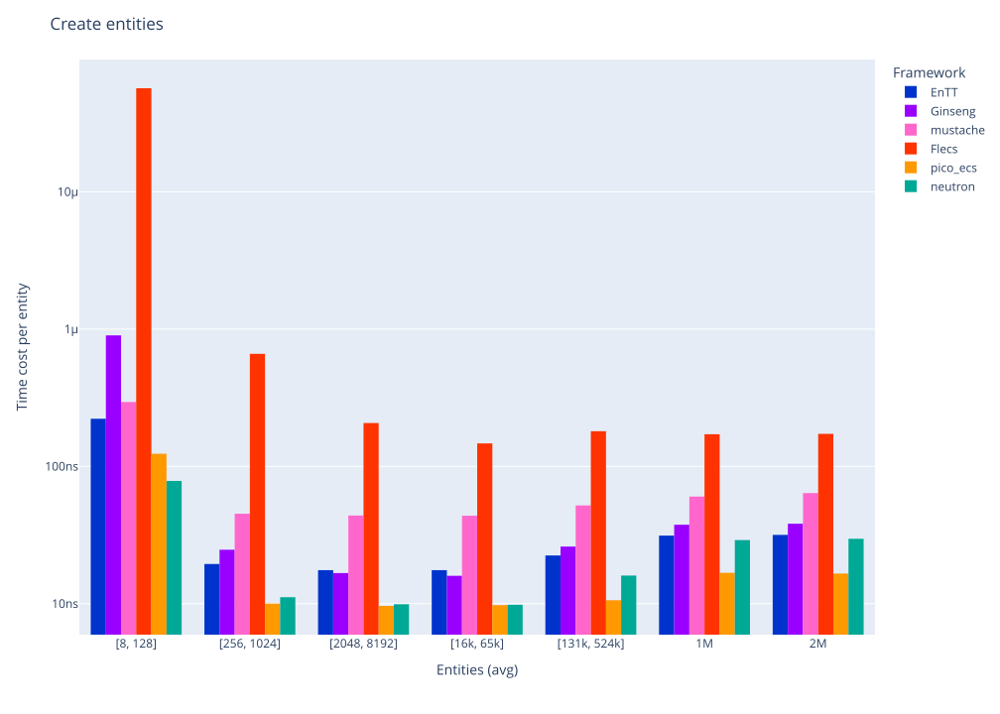

批量创建带组件实体：

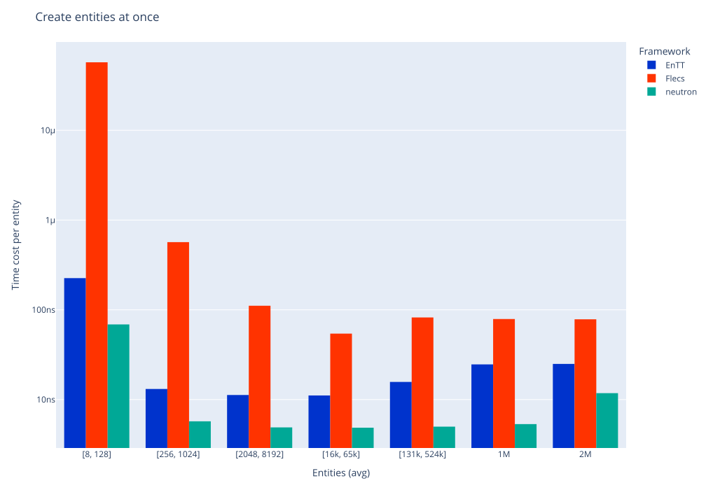

向实体添加组件：

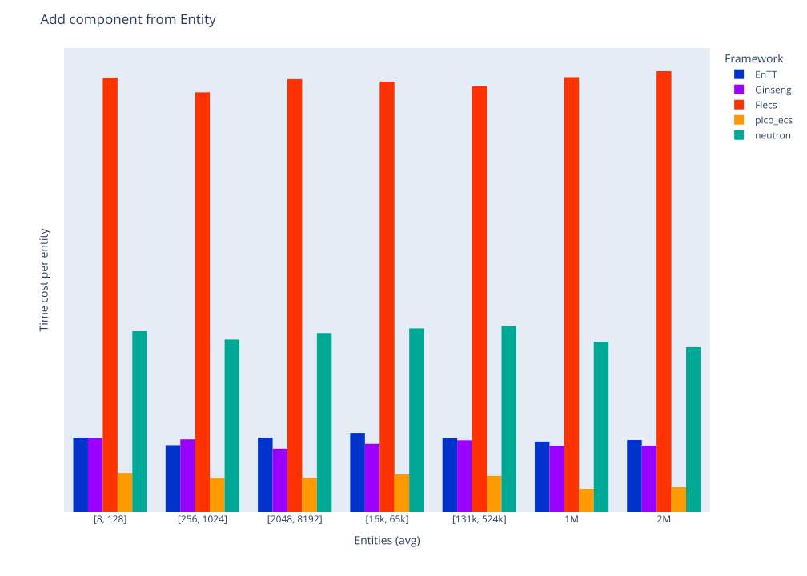

对实体先移除再添加组件：


### 查询与遍历

遍历单组件实体：

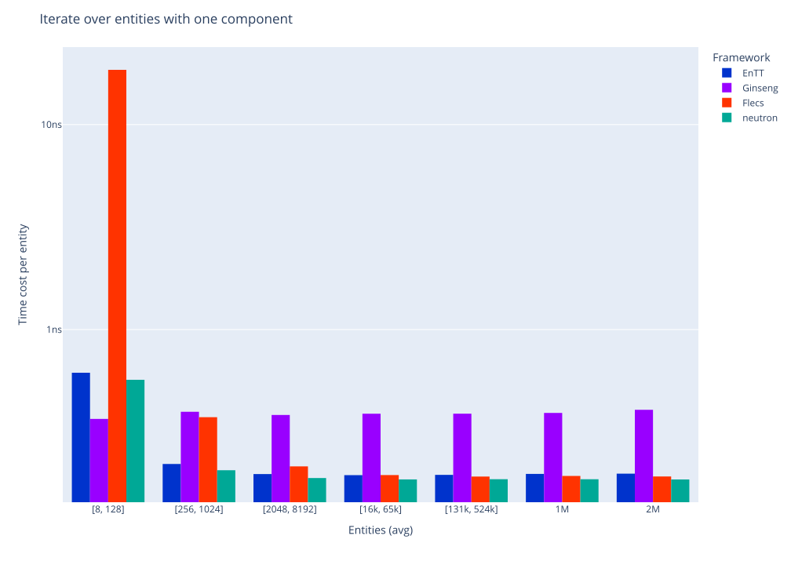

遍历双组件实体：

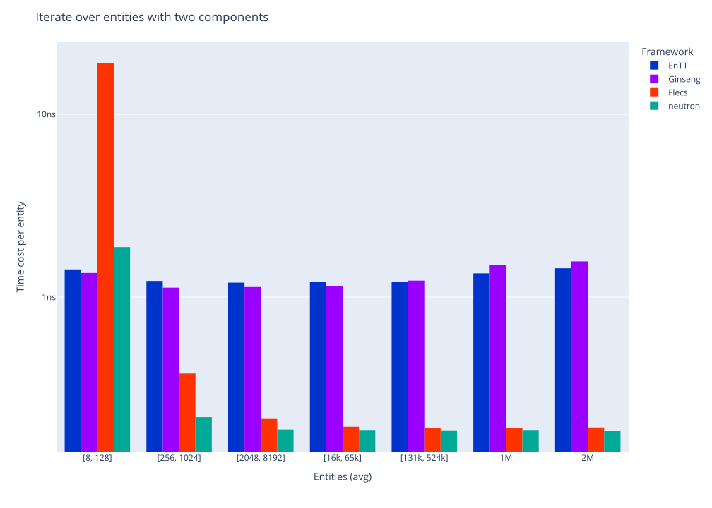

遍历混合实体中的三组件集合：

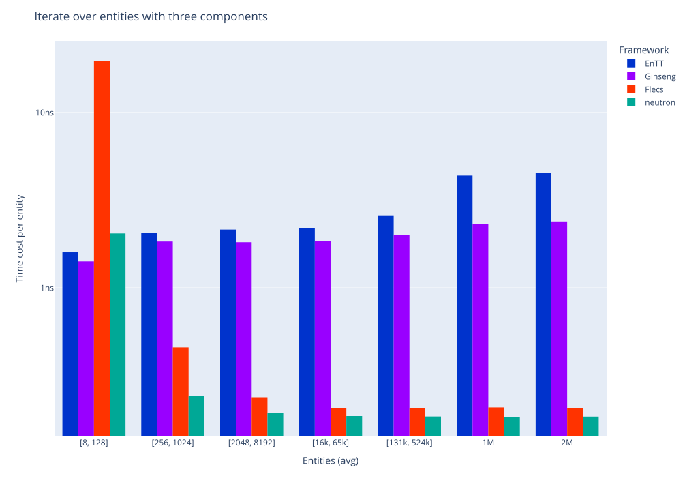

### 实体销毁

逐个销毁实体：

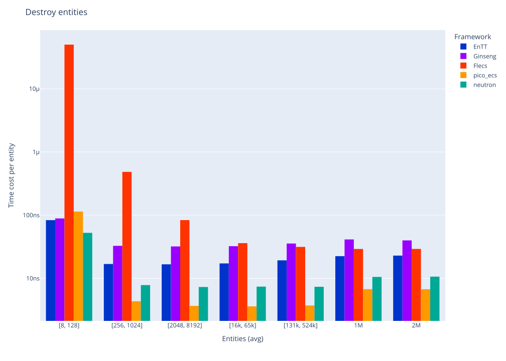

批量销毁实体：

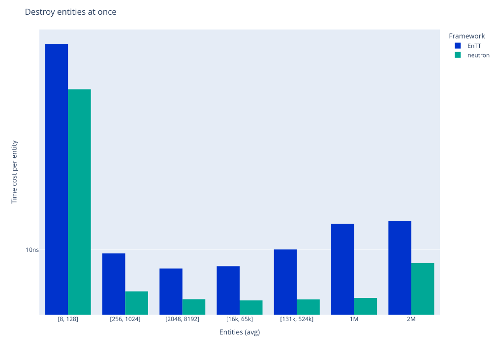

### 系统更新

两系统更新：

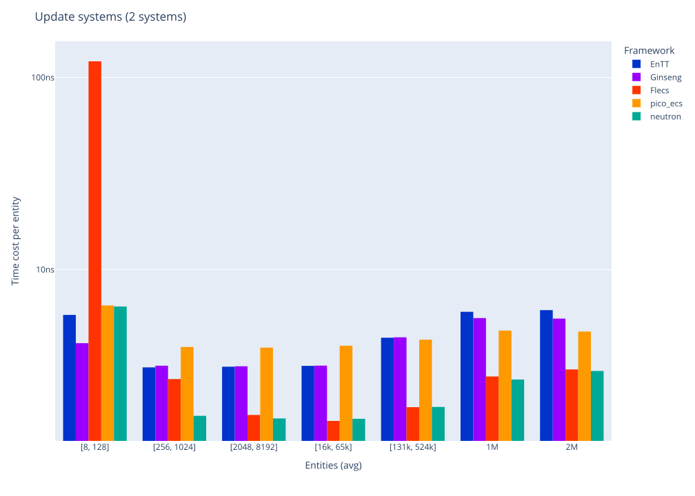

两系统更新, 实体组件混合：

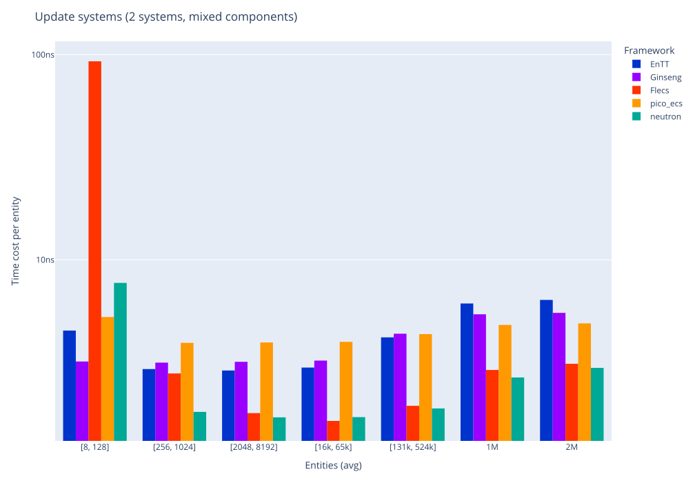

七系统更新：

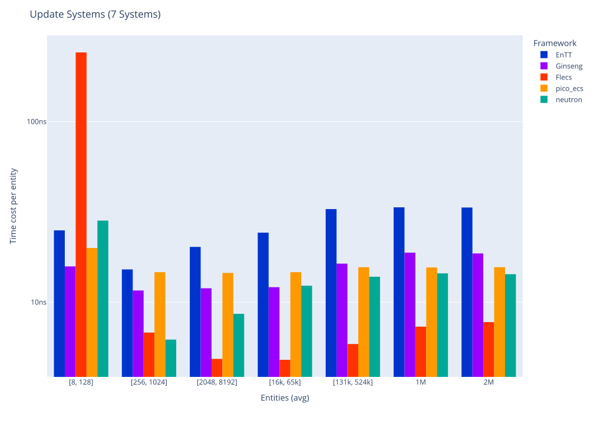

七系统更新, 实体组件混合：

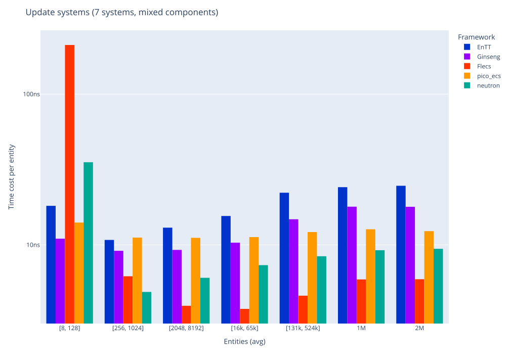

这些图适合观察趋势, 不能代表绝对性能。要分析 `neutron` 的实际表现，应结合具体的系统数量、组件大小和结构变化密度进行测量.
